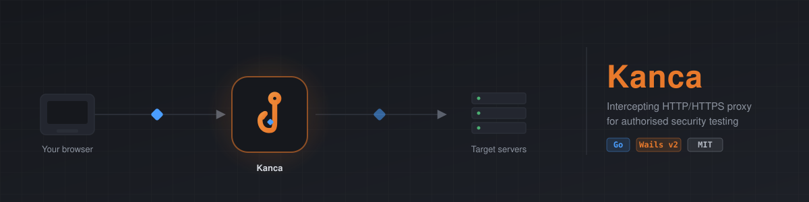
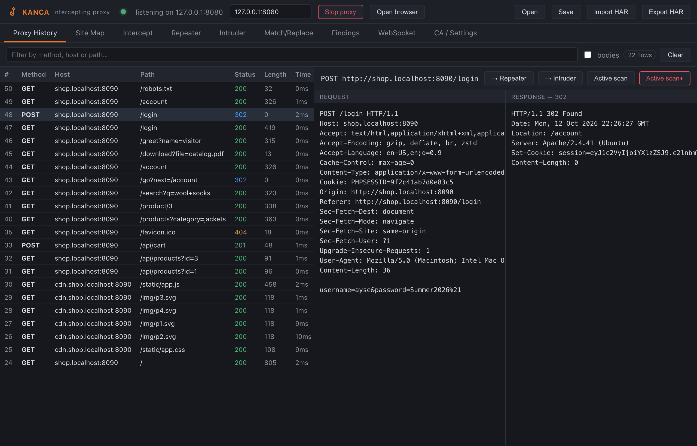
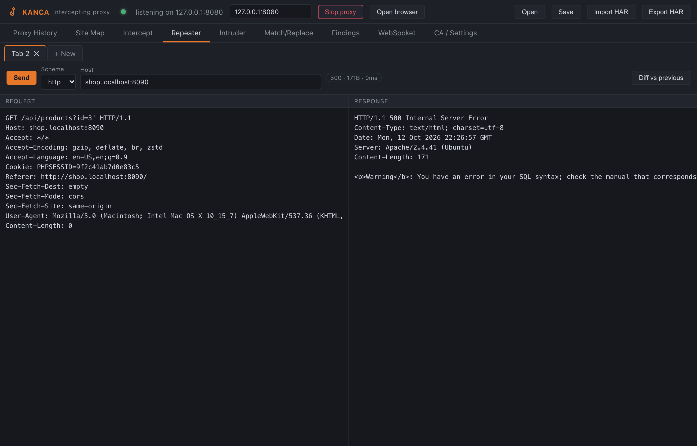
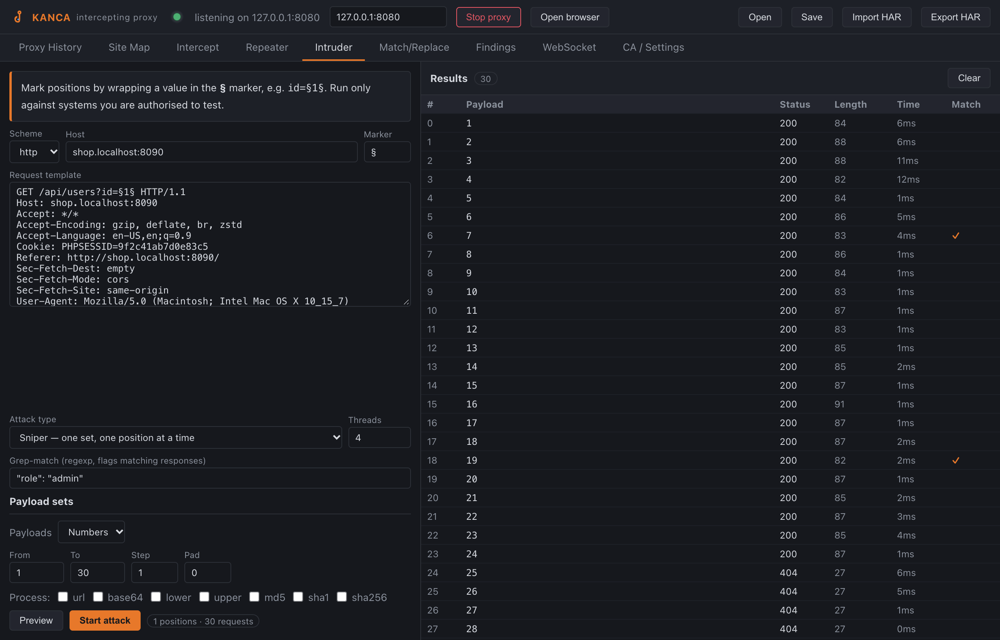
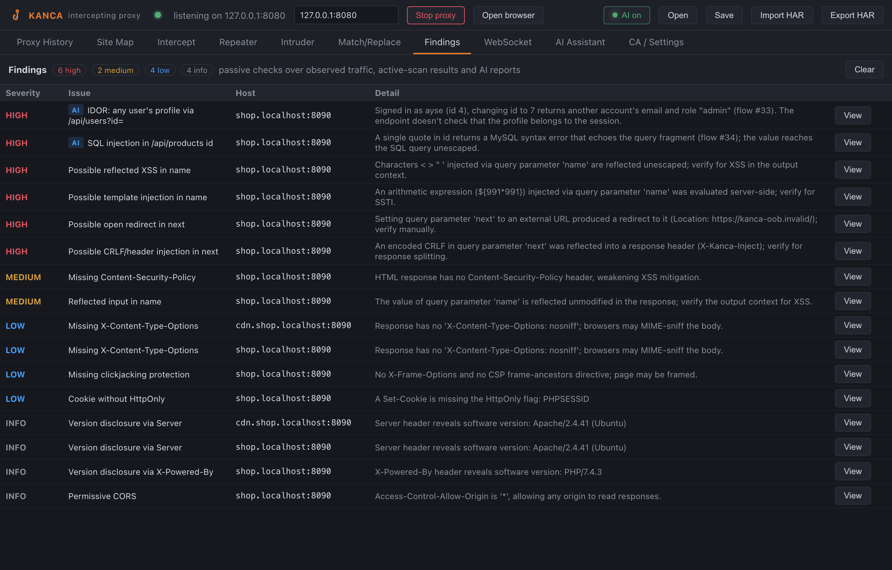
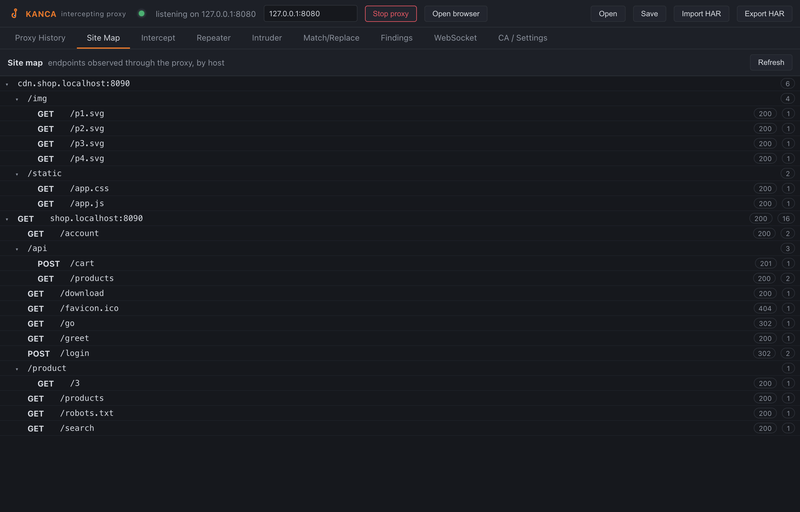
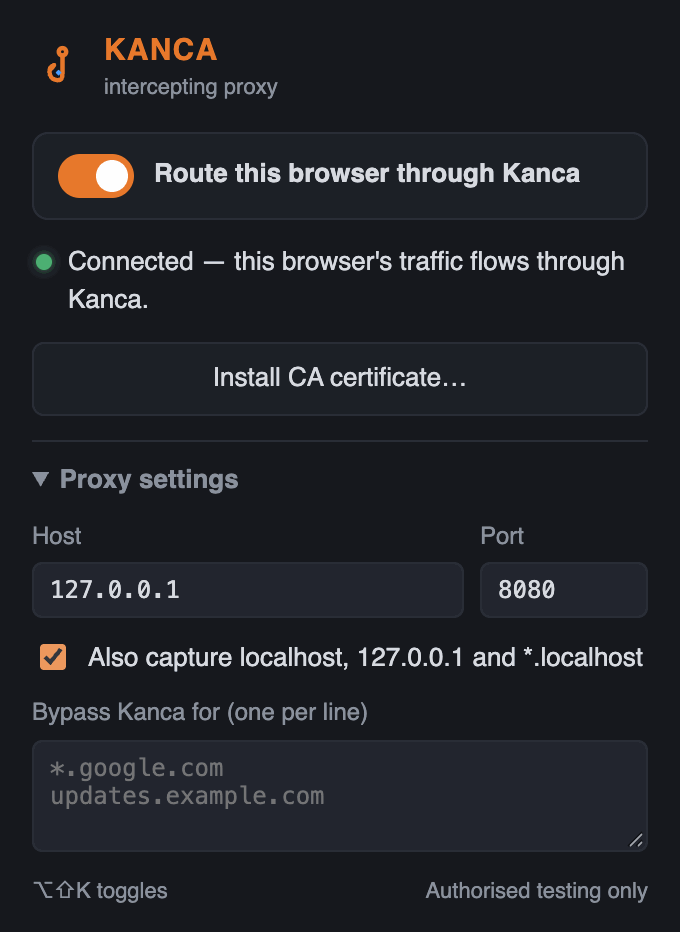
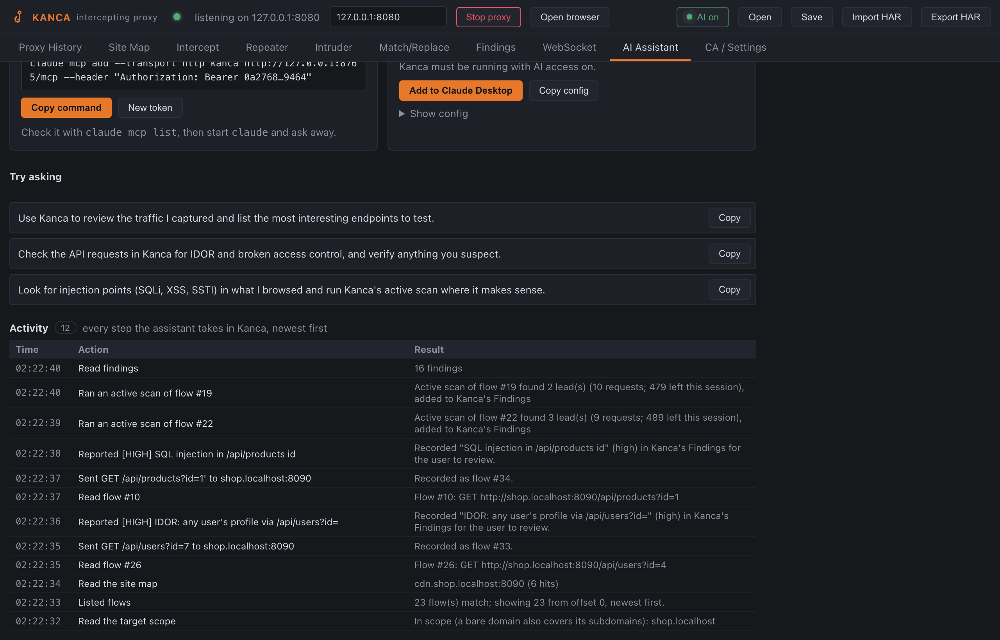

<p align="center">
  
</p>

<p align="center">
  <a href="https://github.com/gorkemguler/Kanca/actions/workflows/ci.yml"></a>
  <a href="https://github.com/gorkemguler/Kanca/blob/main/go.mod"></a>
  <a href="https://github.com/gorkemguler/Kanca/blob/main/LICENSE"></a>
</p>

<p align="center">
  <strong>English</strong> · <a href="README.tr.md">Türkçe</a>
</p>

# Kanca

An intercepting HTTP/HTTPS proxy for **authorised** web-application security
testing — an open, hackable alternative to tools like Burp Suite. Kanca sits
between a browser (or any HTTP client) and the servers it talks to, records
every transaction, and lets you pause, edit, replay and fuzz requests.

> ⚠️ **Authorised use only.** Kanca decrypts and modifies traffic. Use it only
> against systems you own or are explicitly permitted to test. You are
> responsible for complying with all applicable laws and agreements.

## Screenshots



<table>
  <tr>
    <td width="50%"><br><sub><b>Repeater</b> — resending a product lookup with a stray quote surfaces a SQL error.</sub></td>
    <td width="50%"><br><sub><b>Intruder</b> — enumerating user IDs 1–30; grep-match flags the two admin accounts.</sub></td>
  </tr>
  <tr>
    <td width="50%"><br><sub><b>Scanner</b> — targets, one-click <b>Scan targets</b>, and the findings: passive checks, active-scan leads (XSS, SQLi, SSTI, open redirect, CRLF) and issues Claude confirmed (<b>AI</b>).</sub></td>
    <td width="50%"><br><sub><b>Site map</b> — captured endpoints as a per-host tree.</sub></td>
  </tr>
</table>

<sub>Screenshots show Kanca against a deliberately weak demo shop running locally.</sub>

## Installation

### 1. Download and run

Grab the file for your system from the
[latest release](https://github.com/gorkemguler/Kanca/releases/latest):

| Platform | File | Run |
| --- | --- | --- |
| macOS (Intel + Apple silicon) | `kanca-macos-universal.zip` | Unzip, then right-click `kanca.app` → **Open** the first time (it isn't notarised, so Gatekeeper asks once). |
| Windows (x64) | `kanca-windows-amd64.zip` | Unzip and run `kanca.exe`. If SmartScreen warns, choose **More info → Run anyway**. |
| Linux (x64) | `kanca-linux-amd64.tar.gz` | Extract and run `./kanca` (needs `libgtk-3` and `libwebkit2gtk-4.0`). |

Prefer to build it yourself? See [Desktop app](#desktop-app).

### 2. Start intercepting

**Easiest: the Kanca browser.** Click **Open browser** in the top bar. Kanca
starts the proxy and opens Chrome, Edge or Brave in a separate profile that is
already routed through it. HTTPS works right away, so **you can skip step 3**.
See [One-click browser](#one-click-browser).

**Or your own browser.** Route it through Kanca with the
[browser extension](#browser-extension) (Chrome, Edge, Brave, Opera), or set its
HTTP and HTTPS proxy to `127.0.0.1:8080` by hand. Then continue with step 3.

### 3. Trust the Kanca certificate (your own browser only)

To read HTTPS traffic, your browser has to trust Kanca's root certificate. Get
the file by opening `http://kanca/` through the proxy, or with **CA / Settings →
Export to file…**; Kanca also keeps it at `~/.kanca/ca-cert.pem`.

- **macOS**: click **Trust certificate** in the banner Kanca shows while HTTPS
  isn't trusted (or **CA / Settings → Install on this Mac**). macOS asks for your
  password or Touch ID, and the banner disappears once Safari, Chrome and Edge
  trust the certificate. Double-clicking `kanca-ca.crt` is not enough on its
  own: it only adds the certificate, which you'd then have to set to **Always
  Trust** in Keychain Access. Or in Terminal:

  ```bash
  security add-trusted-cert -r trustRoot -p ssl -k ~/Library/Keychains/login.keychain-db ~/.kanca/ca-cert.pem
  ```

- **Windows**: double-click `kanca-ca.crt` → **Install Certificate** → **Current
  User** → **Place all certificates in the following store** → **Trusted Root
  Certification Authorities**. Or in a terminal:

  ```powershell
  certutil -user -addstore Root kanca-ca.crt
  ```

- **Linux**: Chrome, Edge and Chromium use their own certificate database:
  **Settings → Privacy and security → Security → Manage certificates →
  Authorities → Import**. Or, with `libnss3-tools` installed:

  ```bash
  certutil -d sql:$HOME/.pki/nssdb -A -t "C,," -n "Kanca Root CA" -i kanca-ca.crt
  ```

- **Firefox (any OS)** keeps a separate list: **Settings → Privacy & Security →
  Certificates → View Certificates → Authorities → Import**, then tick *Trust this
  CA to identify websites*.

Restart the browser if it was already open. To check, open `http://kanca/`
through the proxy: it says whether this browser trusts the certificate, and so
does the [browser extension](#browser-extension). **Remove the certificate when you're
done testing**: on macOS click **CA / Settings → Remove from this Mac**; on
Windows run `certutil -user -delstore Root "Kanca Root CA"`; elsewhere delete
*Kanca Root CA* where you imported it.

## One-click browser

The quickest way to start: click **Open browser** in Kanca's top bar (or under
**CA / Settings → Browser setup**). Kanca starts the proxy if needed and opens
Chrome, Edge or Brave in a separate profile that is already routed through it.

- **HTTPS works immediately.** The browser is told to trust only Kanca's own
  certificate keys, so there is nothing to install in your OS trust store, and
  every other site keeps normal certificate checks.
- **Your everyday browser is untouched.** The testing profile lives in
  `~/.kanca/browser-profile`, with its own cookies and history.
- **Local targets are captured too**, including `localhost` and `*.localhost`.

Kanca prefers Chrome when it's installed. The browser's own update and sync
traffic is switched off, but Edge still sends a few requests to Microsoft
services; add your site as a target in the **Scanner** tab and tick *Only record
traffic to targets* to keep them out of the history.

From the CLI, `go run ./cmd/kanca -browser` does the same.

## Browser extension



The companion extension for Chrome, Edge, Brave and Opera turns Kanca on and off
for your browser in one click, so you never have to dig through proxy settings:

- **One-click routing** — sends the browser's HTTP and HTTPS traffic to Kanca
  (`127.0.0.1:8080` by default, or any host/port you set). The toolbar icon turns
  orange with an **ON** badge while it's active; <kbd>Alt</kbd>+<kbd>Shift</kbd>+<kbd>K</kbd> toggles it.
- **Live status** — tells you whether traffic is really flowing through Kanca,
  or that Kanca isn't running yet, and whether this browser trusts Kanca's
  certificate (so HTTPS sites won't show warnings).
- **CA certificate** — *Install CA certificate…* opens `http://kanca/`, a page
  Kanca serves itself, to download the root certificate with per-OS steps.
- **Local targets** — optionally capture `localhost`, `127.0.0.1` and `*.localhost`,
  which browsers otherwise send around the proxy.
- **Bypass list** — hosts that should skip Kanca, e.g. `*.google.com` noise.
- **Conflict warning** — flags when another extension (a VPN or proxy switcher)
  or a policy controls the proxy instead.

**Install:** in the Kanca app, open **CA / Settings → Browser setup** and click
**Get the extension**; it writes the extension to `~/.kanca/browser-extension`
and opens that folder. (Or download `kanca-browser-extension.zip` from the
[latest release](https://github.com/gorkemguler/Kanca/releases/latest) and unzip
it.) Then open `chrome://extensions` (`edge://extensions` in Edge), turn on
**Developer mode**, click **Load unpacked** and select the folder. Firefox is not
supported yet.

To see HTTPS traffic, also
[trust the Kanca certificate](#3-trust-the-kanca-certificate-your-own-browser-only).

<br clear="right">

## AI assistant (MCP)



Kanca can work with Claude. You browse the target as usual; Claude, in
[Claude Code](https://claude.com/claude-code) or Claude Desktop, reads what you
captured, looks for vulnerabilities, checks its hunches with its own requests and
records what it confirms in **Findings**. It talks to Kanca over the
[Model Context Protocol](https://modelcontextprotocol.io).

**Turn it on:** add the site as a target in the **Scanner** tab, open the **AI
Assistant** tab and tick **Allow AI assistants to use Kanca**. Then connect Claude:

- **Claude Code**: click **Copy command** and run it once in a terminal. It looks like
  ```bash
  claude mcp add --transport http kanca http://127.0.0.1:8765/mcp --header "Authorization: Bearer <token>"
  ```
- **Claude Desktop**: click **Add to Claude Desktop**, then quit and reopen
  Claude Desktop. Kanca adds itself to `claude_desktop_config.json`, keeping your
  other servers and a `.bak` copy of the file; Claude Desktop starts Kanca's
  binary as a small bridge (`kanca mcp-stdio`), so Kanca must be running with AI
  access on. Move Kanca to its final place (e.g. Applications) first, since the
  entry points at the binary.
- **Opencode**: in the same tab open **Connect Opencode**. Remote keeps the
  secret out of the file (`Bearer {env:KANCA_MCP_TOKEN}`, `oauth:false`;
  first run `export KANCA_MCP_TOKEN="$(jq -r .token ~/.kanca/mcp.json)"`),
  local uses `{"type":"local","command":["kanca","mcp-stdio"]}` with no secret
  (the app's copy button fills in the full path to Kanca; the example assumes
  `kanca` is on your `PATH`).
  Verify with `opencode mcp list` / `opencode mcp debug kanca`. See
  `opencode.json.example` (remote) and `opencode.local.json.example` (local).

Then ask, for example: *"Check the API requests in Kanca for IDOR and broken
access control, and verify anything you suspect."*

| Tool | What Claude can do with it |
| --- | --- |
| `list_flows`, `get_flow` | List and filter captured requests; read a request and its (decoded) response. |
| `get_sitemap`, `get_scope` | See the target's structure and what it is allowed to test. |
| `list_findings`, `add_finding` | Read Kanca's findings and record new ones with evidence. |
| `send_request` | Send a raw request to one of your targets; it is recorded in Proxy History. |
| `active_scan` | Run Kanca's [active scanner](#features-mvp) on a captured request. |

Guard rails:

- **Local only.** The endpoint listens on `127.0.0.1:8765`, needs a random
  256-bit token (kept in `~/.kanca/mcp.json`, readable only by you) and refuses
  requests from web pages. **New token** cuts off every connected client.
- **Targets only.** Claude can read everything Kanca captured, but send requests
  and run scans only against your targets; with no targets it can only read.
  **Read only** mode takes sending away altogether.
- **Budgeted.** At most 500 requests per session, active-scan probes included.
  Turning AI access off and on starts a new session.
- **Secrets masked by default.** Cookies, tokens, passwords, API keys and JWTs
  reach Claude as placeholders like `[[KANCA_SECRET_1]]`, and Kanca puts the real
  values back when Claude sends a request. Untick **Mask secrets** to show them.
- **Nothing hidden.** The **Activity** list shows every step Claude takes,
  requests it sends are tagged **AI** in Proxy History, and its findings carry an
  **AI** badge.

> Whatever Claude reads is sent to Anthropic as part of your conversation. Use
> it only on targets you're allowed to test and whose data you may share.

Without the GUI, `kanca -scope shop.example -mcp` serves the same endpoint from
the [CLI](#quick-start--headless-cli) and prints the commands to connect.

## Features (MVP)

| Feature | What it does |
| --- | --- |
| **Intercepting proxy** | Terminates TLS with an on-the-fly per-host certificate signed by a local root CA, so HTTPS traffic can be inspected and modified. |
| **HTTP history** | Every request/response is captured, searchable and filterable, with the full raw bytes of each side. Filter by method and hidden status codes, save filter presets, and tag flows with notes and highlight colours. Any flow can emit a CSRF proof-of-concept form. |
| **Interception queue** | Pause requests (and optionally responses), edit the raw bytes, then forward or drop them. |
| **Repeater** | Take any request, tweak it freely, and resend it as many times as you like — each tab keeps its own send history, and a line diff compares a response with the previous send. |
| **Comparer** | Compare any two texts side by side: two responses, two requests, or pasted payloads — load either side straight from a history flow. |
| **JWT workbench** | Decode a token, edit its payload, re-sign it (HS256/384/512) or strip it to `none`, and verify against a secret. |
| **Intruder / fuzzer** | Automated payload injection with four attack types (sniper, battering ram, pitchfork, cluster bomb), concurrency control, inter-request delay, pause/resume, grep-match highlighting and grep-extract harvesting. Positions are marked with the `FUZZ` keyword; payload sets come from a list or a generated numeric range, with per-set processors (URL/base64 encode, upper/lower, MD5/SHA-1/SHA-256). Combination space is capped for safety. |
| **Targets** | Set in the **Scanner** tab: the hosts you may test (exact, parent-domain or `*.` wildcard; pasting a URL works). Active scans, site scans and the AI assistant refuse anything else, while every site is still recorded unless you choose *Only record traffic to targets*. |
| **Readable bodies** | Browsers ask for `br` and `zstd`, which Kanca can't decode, so it asks servers only for `gzip` and `deflate` and decodes those for display, search, Intruder grep and scanning. |
| **Site map** | Captured traffic arranged as a per-host tree of URL paths, so you can see a target's structure rather than a flat log. |
| **Match & replace** | Regex substitutions applied on the wire — rewrite the request line, a header, or the body of outbound requests and inbound responses (Content-Length is kept correct). |
| **Body search** | Filter the history across request/response bodies, not just method/host/path. |
| **Passive scanner** | Flags security issues from observed traffic (missing CSP/HSTS/X-Content-Type-Options, insecure cookies, permissive CORS, version disclosure) without sending any extra requests. |
| **Site scan** | **Scan targets** in the Scanner tab (or **Scan site** on a host in the Site Map) runs the active scanner over every captured request with parameters on your targets, one at a time, with live progress; the findings appear right below. Forms and other state-changing requests are only included when you tick them, since each probe submits them again; DELETE needs its own opt-in, and query/form/JSON insertion points can be toggled. Findings carry a triage status (new/confirmed/resolved/false-positive). |
| **Active scanner** | On demand, probes one request's insertion points — query, form-body and JSON-body parameters — for reflected input/XSS, error-based SQL injection, path traversal, open redirect, template injection (SSTI) and CRLF/header injection, restricted to your targets. An opt-in **aggressive** mode adds boolean- and time-based SQLi and time-based command-injection checks (these make the target do observable work). Detection-only: every check compares against a baseline and flags a lead to verify by hand — it never attempts exploitation. |
| **Save / import / export** | Save a full session (flows, rules, findings, scope) to a project file and reopen it later; export captured traffic as HAR 1.2 and import HAR captures from other tools. |
| **WebSocket support** | `ws://` and `wss://` upgrades are bridged transparently (they used to break, since `Upgrade`/`Connection` are stripped as hop-by-hop for ordinary HTTP) with a live, per-connection frame log — hand-rolled RFC 6455 framing, no dependency. |
| **AI assistant (MCP)** | Lets [Claude](#ai-assistant-mcp) read captured traffic, send requests and run scans against your targets, and report findings, with secrets masked and every step shown. |
| **Browser setup** | [Open browser](#one-click-browser) launches a pre-configured, isolated Chrome/Edge/Brave profile where HTTPS works without installing the CA; a [browser extension](#browser-extension) routes your own browser; and `http://kanca/` — served by the proxy itself, never forwarded or recorded — offers the root CA for download. |

## Architecture

The project is split into two Go modules so the engine stays dependency-free
and fully testable, while the desktop shell carries the GUI toolchain.

```
kanca/                      core module — pure Go standard library, no deps
├── internal/
│   ├── cert/               on-the-fly certificate authority (root + leaves)
│   ├── proxy/              the intercepting proxy engine + HTTP wire codec
│   │                       (incl. WebSocket bridging/frame capture)
│   ├── history/            searchable, bounded flow log
│   ├── repeater/           edit-and-resend workspaces
│   ├── intruder/           payload templating + concurrent attack engine
│   ├── rules/              match-and-replace (on-the-wire regex rewrites)
│   ├── scanner/            passive security checks over captured flows
│   ├── activescan/         non-destructive active probes (opt-in, scope-gated)
│   ├── sitemap/            per-host URL path tree built from captured flows
│   ├── scope/              target-scope host matching
│   ├── mcp/                MCP server for AI assistants (+ stdio bridge)
│   ├── diff/               line-oriented text diff (repeater response compare)
│   ├── jwt/                JWT decode/verify/forge (HS256/384/512 and none)
│   ├── har/                HAR 1.2 export and import
│   └── project/            save/load a session (flows, rules, findings, scope)
├── cmd/kanca/              headless CLI runner (no GUI required)
└── desktop/                separate module — Wails v2 desktop app
    ├── app.go              Go ↔ frontend bindings
    ├── main.go             Wails entry point
    └── frontend/           React + TypeScript UI (Vite)
```

Because the core module has **zero external dependencies**, it builds and its
tests run anywhere Go is installed — CI needs nothing else.

## Quick start — headless CLI

The CLI runs the full proxy engine without a GUI; handy for servers, CI, or
just verifying things work.

```bash
go run ./cmd/kanca -addr 127.0.0.1:8080
```

Then point your browser's HTTP/HTTPS proxy at `127.0.0.1:8080` (or switch on the
[browser extension](#browser-extension)), or pass `-browser` to open a browser
that's already set up. To intercept HTTPS in your own browser, browse to
`http://kanca/` through the proxy and download the root certificate, or export it
from the CLI, then [trust it](#3-trust-the-kanca-certificate-your-own-browser-only):

```bash
go run ./cmd/kanca -export-ca kanca-ca.pem
```

Flags:

| Flag | Default | Meaning |
| --- | --- | --- |
| `-addr` | `127.0.0.1:8080` | proxy listen address |
| `-cadir` | `~/.kanca` | where the root CA is stored |
| `-export-ca PATH` | — | write the root certificate to `PATH` and exit |
| `-insecure-upstream` | `true` | skip verification of upstream server certs |
| `-max-flows` | `100000` | max transactions retained in memory |
| `-browser` | `false` | open Chrome/Edge/Brave in a dedicated profile already routed through the proxy |
| `-scope HOSTS` | — | comma-separated target hosts; only these are recorded, and only these may be tested by an AI assistant |
| `-mcp` | `false` | serve the [AI assistant](#ai-assistant-mcp) endpoint on `127.0.0.1:8765` |
| `-mcp-readonly` | `false` | with `-mcp`: the assistant may read traffic but not send requests |
| `-mcp-no-mask` | `false` | with `-mcp`: show cookies, tokens and passwords to the assistant unmasked |

`kanca mcp-stdio` is the bridge Claude Desktop launches to reach a running Kanca.

## Desktop app

The GUI is a [Wails v2](https://wails.io) application. You need Go, Node.js and
the Wails CLI, plus the platform webview dependencies Wails documents
(e.g. `webkit2gtk` on Linux, WebView2 on Windows).

```bash
go install github.com/wailsapp/wails/v2/cmd/wails@latest

cd desktop
wails dev      # live-reload development
wails build    # produce a native binary in desktop/build/bin
```

On first launch, click **Open browser** to get a browser that is already routed
through Kanca. To use your own browser instead, open **CA / Settings → Browser
setup**, add the extension, and trust the root certificate.

## Development

```bash
# core engine: build, vet, test (no external deps)
go build ./...
go vet ./...
go test ./...

# frontend type-check + build, and unit tests (Node 24+, no dependencies)
cd desktop/frontend && npm install && npm run build && npm test

# browser extension unit tests (no dependencies)
cd extension && npm test
```

The proxy engine is covered by end-to-end tests that stand up real HTTP and
HTTPS backends and drive traffic through the proxy, including interception
drop/edit paths (`internal/proxy/proxy_test.go`).

## Roadmap

Shipped recently: request comparer, JWT workbench, finding triage workflow,
history annotations and filter presets, CSRF PoC generation, Intruder
pause/resume/delay/extract, FUZZ keyword positions, DELETE opt-in and
insertion-point toggles for site scans, and richer HAR exports.

Possible future work: authentication/session handling helpers (login macros,
multi-user contexts), a built-in wordlist manager, spidering/AJAX crawling,
stored/DOM XSS and SSRF checks, and out-of-band (OAST) interaction detection.

## License

MIT — see [LICENSE](LICENSE).
